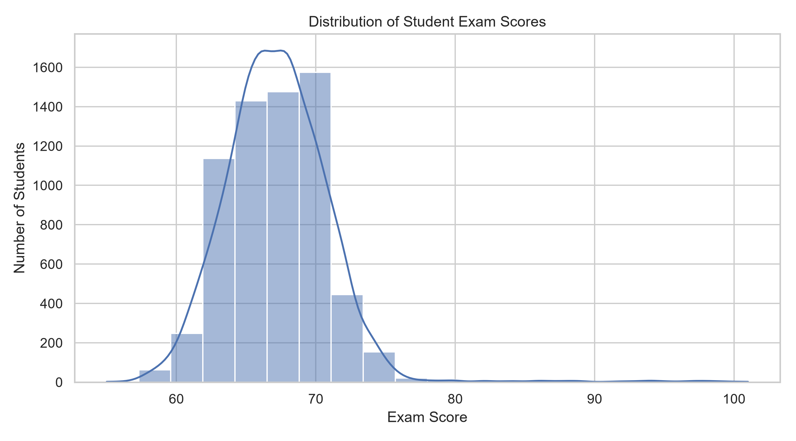
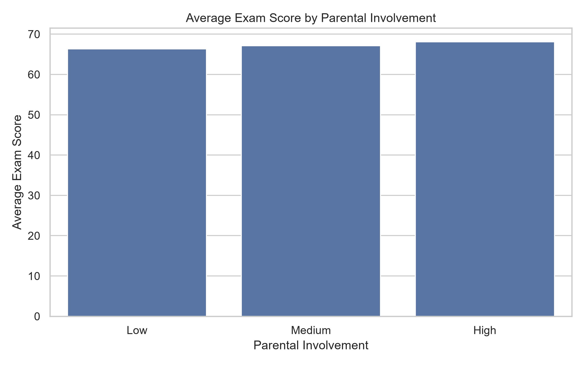
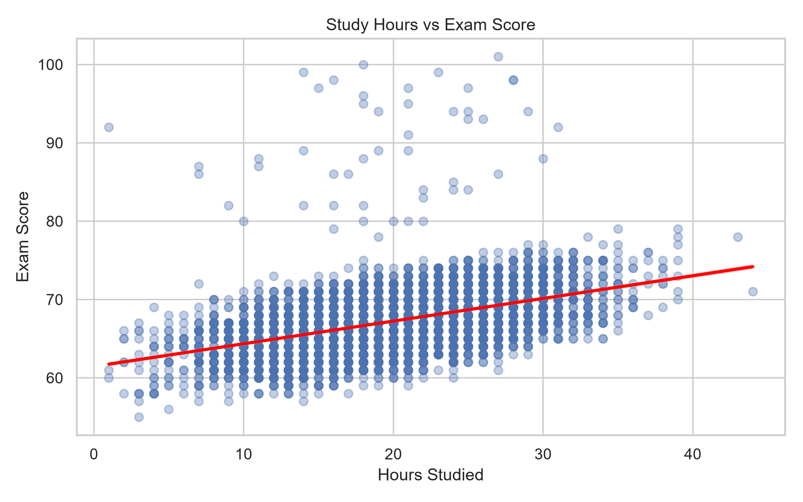
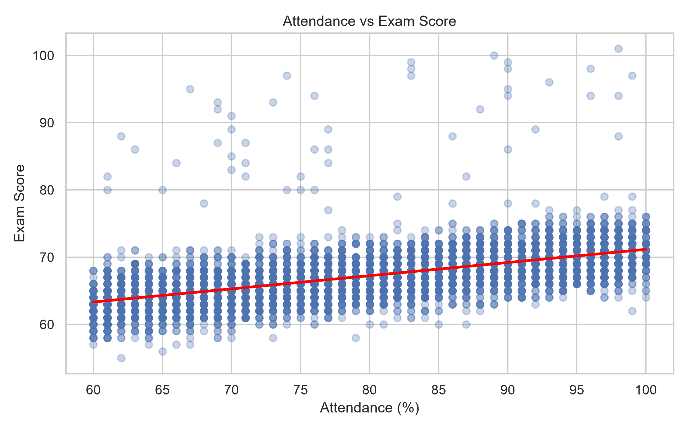
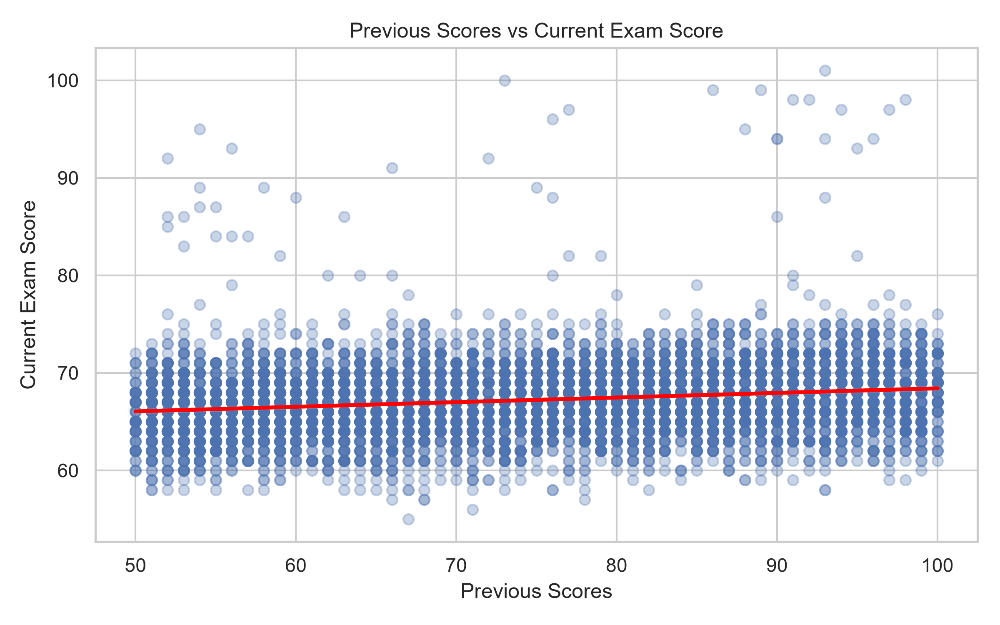
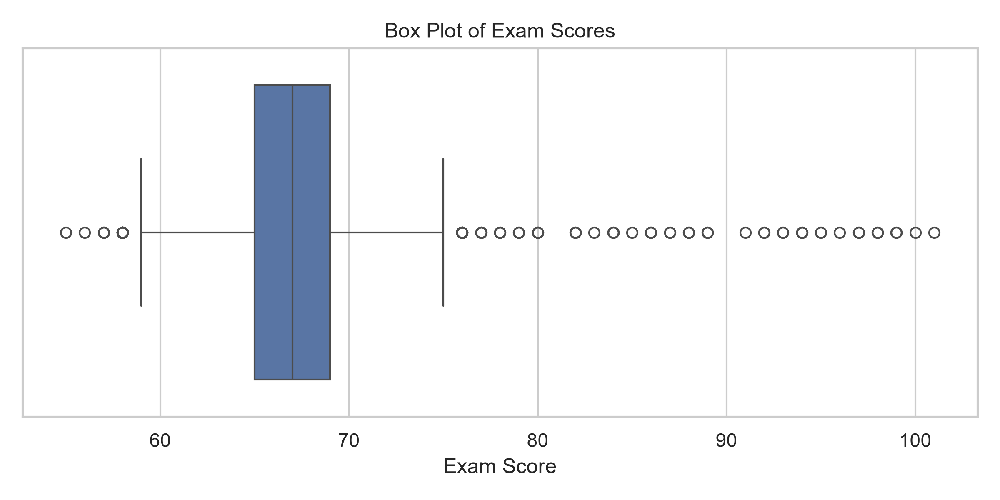

# Student Performance Analysis and Prediction System

A machine-learning-based student performance analysis project built using **Python, NumPy, Pandas, Matplotlib, Seaborn, and Scikit-learn**.

The project analyses student-related academic and personal factors, explores patterns that may influence examination performance, and predicts final exam scores using a regression model. It is an educational machine-learning project intended to demonstrate data analysis, visualisation, preprocessing, and predictive modelling.

## Project and Internship Information

| Detail | Information |
|---|---|
| Project | Student Performance Analysis and Prediction System |
| Student | Shubham Aher |
| Internship Organization | InternsElite |
| Internship Domain | AI/ML with Python |
| Internship Duration | 3 months |
| Academic Affiliation | Sanjivani University, Kopargaon |
| Academic Year | 2025–2028 |

## Key Features

- Inspect and analyse a student performance dataset.
- Handle missing values and duplicate records.
- Perform data cleaning and preprocessing using Pandas and NumPy.
- Calculate descriptive statistics to understand student performance.
- Explore relationships between academic factors and examination scores.
- Create visualisations using Matplotlib and Seaborn.
- Analyse study hours, attendance, sleep, previous scores, and other student-related factors.
- Train a Ridge Regression model to predict examination scores.
- Apply feature scaling and median imputation through a machine-learning pipeline.
- Use GridSearchCV for hyperparameter tuning.
- Perform 5-fold cross-validation.
- Evaluate the model using MAE, RMSE, and R².
- Generate sample student performance predictions.
- Save the trained model using Joblib.

## Technology Stack

- **Programming Language:** Python
- **Data Analysis:** Pandas, NumPy
- **Data Visualisation:** Matplotlib, Seaborn
- **Machine Learning:** Scikit-learn
- **Regression Algorithm:** Ridge Regression
- **Model Persistence:** Joblib
- **Development Environment:** Visual Studio Code
- **Operating System:** Windows

## Dataset

This project uses the **Student Performance Factors** dataset stored as:

`Student Performance Factors.csv`

The dataset contains **6,607 student records and 20 columns** describing academic, personal, family, and school-related factors.

### Dataset Features

Some important dataset columns include:

- `Hours_Studied`
- `Attendance`
- `Parental_Involvement`
- `Access_to_Resources`
- `Extracurricular_Activities`
- `Sleep_Hours`
- `Previous_Scores`
- `Motivation_Level`
- `Internet_Access`
- `Tutoring_Sessions`
- `Family_Income`
- `Teacher_Quality`
- `School_Type`
- `Peer_Influence`
- `Physical_Activity`
- `Learning_Disabilities`
- `Parental_Education_Level`
- `Distance_from_Home`
- `Gender`
- `Exam_Score`

**Target variable:** `Exam_Score`

### Data Preprocessing

The dataset preprocessing includes:

- Checking and handling missing values.
- Removing duplicate records.
- Applying mode imputation to missing categorical values.
- Preparing numerical features for machine learning.
- Separating input features and the target variable.

The dataset contains missing values in `Teacher_Quality`, `Parental_Education_Level`, and `Distance_from_Home`.

**Dataset source:** Add the original dataset download URL or provider attribution here before publishing the repository. The exact source URL has not been verified in the available project information.

## Project Structure

```text
Student-Performance-Analysis-and-Prediction-System/
├── data/
│   └── Student Performance Factors.csv
├── notebooks/
│   └── student_performance_analysis.ipynb
├── src/
│   ├── model.py
│   └── student_performance_model.joblib
├── outputs/
│   ├── visualizations/
│   │   ├── exam_score_distribution.png
│   │   ├── average_score_by_parental_involvement.png
│   │   ├── study_hours_vs_exam_score.png
│   │   ├── numerical_correlation_heatmap.png
│   │   ├── attendance_vs_exam_score.png
│   │   ├── previous_scores_vs_exam_score.png
│   │   └── exam_score_boxplot.png
│   └── evaluation_results/
│       ├── actual_vs_predicted_results.csv
│       ├── descriptive_statistics.csv
│       ├── model_comparison.csv
│       ├── model_evaluation_metrics.csv
│       ├── standalone_model_metrics.csv
│       ├── standalone_predictions.csv
│       └── sample_student_predictions.csv
├── screenshots/
├── README.md
└── requirements.txt
```

*The structure above is a guide. Keep the filenames consistent with the actual files in your GitHub repository.*

## Setup and Installation

### 1. Clone the repository

```bash
git clone https://github.com/shubhamaher95/Student-Performance-Analysis-and-Prediction-System.git
cd Student-Performance-Analysis-and-Prediction-System
```

### 2. Create and activate a virtual environment

**Windows PowerShell:**

```powershell
python -m venv .venv
.\.venv\Scripts\Activate.ps1
```

If PowerShell blocks activation, use Command Prompt:

```cmd
.venv\Scripts\activate.bat
```

### 3. Install dependencies

```bash
python -m pip install --upgrade pip
python -m pip install -r requirements.txt
```

### 4. Verify the dataset

Make sure the dataset is available at:

```text
data/Student Performance Factors.csv
```

## Run the Project

Run the following commands from the repository root after activating the virtual environment.

### Run the analysis notebook

Open the notebook inside the `notebooks/` directory using Jupyter Notebook or Visual Studio Code.

### Run the machine-learning model

```powershell
python src/model.py
```

The model script performs preprocessing, hyperparameter tuning, model training, evaluation, and prediction generation.

The trained model is saved as:

```text
src/student_performance_model.joblib
```

## Model Development and Evaluation

The project uses **Ridge Regression**, a regularised linear regression algorithm, to predict student examination scores.

### Input Features

The model uses six numerical input features:

1. `Hours_Studied`
2. `Attendance`
3. `Sleep_Hours`
4. `Previous_Scores`
5. `Tutoring_Sessions`
6. `Physical_Activity`

### Machine Learning Workflow

1. Load the student performance dataset.
2. Select input features and the target variable.
3. Split the dataset into training and testing sets.
4. Handle missing numerical values using median imputation.
5. Standardise numerical features using StandardScaler.
6. Apply Ridge Regression.
7. Perform hyperparameter tuning using GridSearchCV.
8. Evaluate the model using a test dataset.
9. Perform 5-fold cross-validation.
10. Generate predictions and save evaluation results.

The dataset is divided using an 80:20 training and testing split with `random_state=42`.

### Model Evaluation Results

The following results were reported by the current model implementation:

| Evaluation Metric | Result |
|---|---:|
| Mean Absolute Error (MAE) | 1.266 |
| Root Mean Squared Error (RMSE) | 2.251 |
| R² Score | 0.642 |
| Best Alpha | 0.010 |
| Cross-Validation MAE | 1.327 |

**Model interpretation:** The R² score of 0.642 indicates that the model explains approximately 64.2% of the variation in examination scores on the evaluated test data.

The MAE of 1.266 indicates an average absolute prediction error of approximately 1.266 exam-score points.

*These are the reported results from the current Ridge Regression implementation. They should be regenerated if the dataset, features, preprocessing, or model configuration changes.*

### Sample Prediction

Example input:

| Feature | Value |
|---|---:|
| Hours Studied | 3 |
| Attendance | 90 |
| Sleep Hours | 8 |
| Previous Scores | 75 |
| Tutoring Sessions | 2 |
| Physical Activity | 4 |

**Predicted Exam Score: 64.69**

This is an illustrative prediction generated using the current model, not a guaranteed student result.

## Data Visualisations

The project includes several visualisations to understand student performance patterns.

### Exam Score Distribution



### Average Score by Parental Involvement



### Study Hours vs Exam Score



### Numerical Correlation Heatmap


### Attendance vs Exam Score



### Previous Scores vs Exam Score



### Exam Score Box Plot



*Check that each image filename matches the actual file in your repository. GitHub won't display images if their paths are wrong.*

## Important Limitations

- Student examination performance depends on many factors that may not be included in the dataset.
- The model uses only six selected numerical features for prediction.
- Dataset quality and missing values can affect model performance.
- The model learns statistical patterns from historical data; it does not establish causal relationships.
- Predictions are estimates and should not be treated as guaranteed examination results.
- Performance on the test dataset does not guarantee the same performance on new student data.
- The model's results depend on the dataset and the selected features.

This project is an educational prediction prototype and should not be used as the sole basis for academic decisions.

## Future Improvements

- Compare Ridge Regression with Linear Regression and other regression algorithms.
- Add more relevant student performance features.
- Improve feature engineering and data preprocessing.
- Develop a student performance prediction web application.
- Add pass/fail classification as an additional prediction task.
- Improve model performance through further hyperparameter tuning.
- Evaluate the model on additional student datasets.
- Add interactive visualisations and a user-friendly interface.

## Author

**Shubham Aher**

Internship Organization: **InternsElite**  
Internship Domain: **AI/ML with Python**  
Duration: **3 months**  
Academic Affiliation: **Sanjivani University, Kopargaon**

## Acknowledgements

I would like to acknowledge **InternsElite** for providing the internship opportunity and practical learning experience in Artificial Intelligence and Machine Learning with Python.

## License

No license has been specified for this repository yet. Add an appropriate open-source license only after confirming that you have the rights to license all included code, datasets, and other assets.
